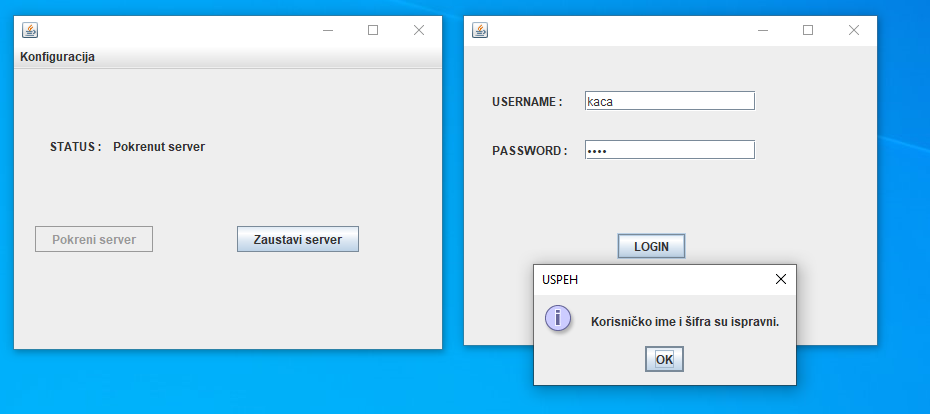
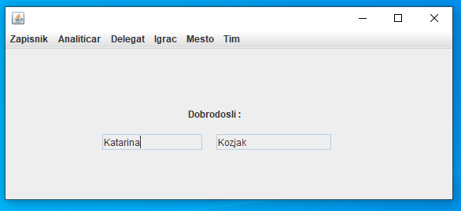
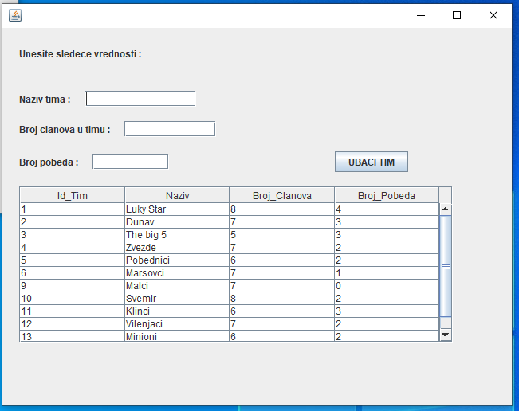
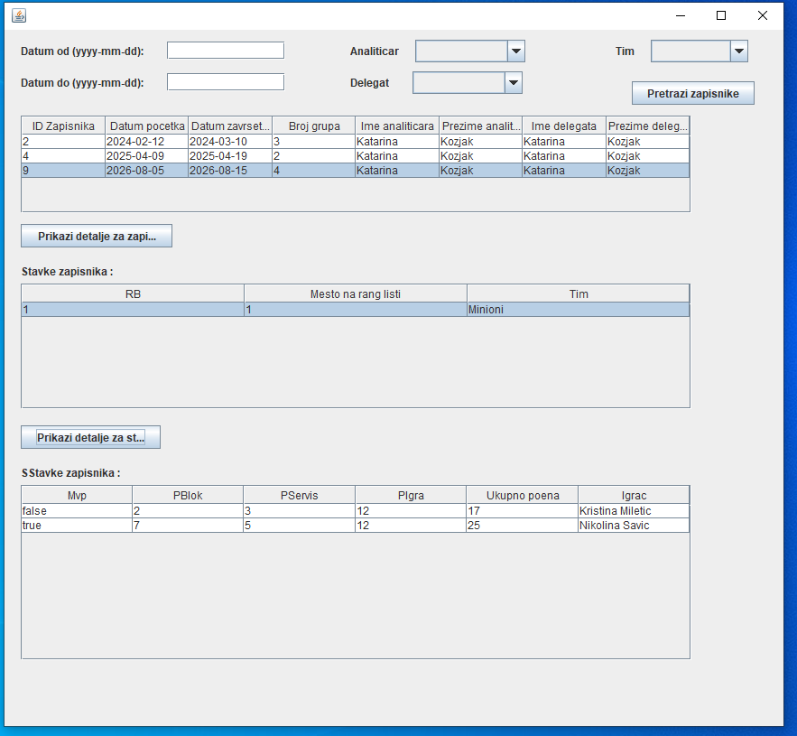

# Volleyball Tournament Management System

A Java desktop application developed for managing volleyball tournaments using a client-server architecture.

The system supports tournament administration, player and team management, match record processing, and communication with a relational database.

## Technologies

- **Java** – Application development
- **Java Swing** – Graphical user interface
- **MySQL** – Relational database
- **JDBC** – Database connectivity
- **Apache NetBeans** – Development environment
- **Object-Oriented Programming (OOP)** – Application design

## Key Features

- User authentication and login functionality
- Player and team management
- Management of tournament locations
- Creation and modification of match records
- Search and filtering of tournament data
- Management of delegates and analysts
- CRUD operations for database records
- Client-server communication
- Database integration using JDBC

## Project Architecture

The application follows a three-module client-server architecture:

### 1. Seminarski_Klijent

Contains the graphical user interface developed with Java Swing, including forms, controllers, and user interaction logic.

### 2. Seminarski_Server

Handles client requests, business logic, system operations, and database communication.

### 3. Seminarski_Zajednicko

Contains shared domain models and communication classes used by both the client and server applications.

## Database

The application uses a MySQL-compatible relational database.

The SQL script is included in the repository:

`odbojkaski_turnir.sql`

## Application Screenshots

The following screenshots showcase the main features
and user interface of the application.

### Login Screen

### Main Dashboard

### Team Management

### Match Record Management

## Project Documentation

Detailed project documentation, including UML diagrams,
system architecture, database design, and application
screenshots, is available in Serbian.

[View Project Documentation](docs/Katarina_Kozjak.pdf)

## How to Run

1. Install Java JDK, Apache NetBeans, and MySQL.
2. Import the database using the provided SQL script.
3. Open the three Java modules in Apache NetBeans.
4. Configure the database connection in the server configuration file.
5. Build the projects and resolve any required libraries.
6. Start `Seminarski_Server`.
7. Start `Seminarski_Klijent`.
8. Log in and use the application.

## Project Purpose

This project was developed to demonstrate practical knowledge of Java programming, object-oriented programming (OOP), client-server architecture, and relational database management.

It combines Java Swing, JDBC, and MySQL to implement a desktop information system for managing volleyball tournaments, including player and team management, match records, and administrative operations.
